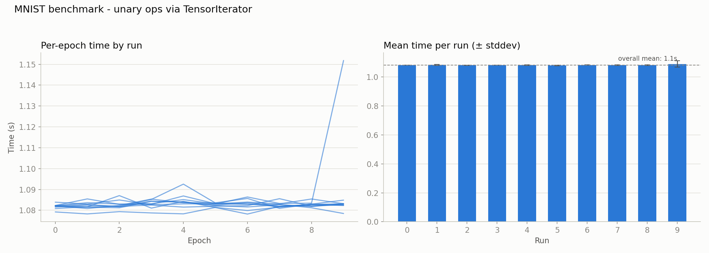

# 014 – Unary ops: routing through TensorIterator and cpu_kernel

**Period:** 2026-09-17 – 2026-09-29
**Commit(s):** `48b7b96` … `f3a2792`

## Goal

[013](013-matmul-neon-kernel.md) concluded that multi-threading is next. Adding
it to the code as it stood would have meant adding it per op — every op carries
its own loop with its own contiguous/strided split, so grain size, thread count
and scheduling would be copied once per op and re-tuned in every copy.
[008](008-elementwise-still-scalar.md) shows that cost is real: the fast path
from [004](004-elementwise-odometer-iteration.md) lived in `elementwise_binary`
but never reached `sum`, which is why [011](011-sum-outer-reduce-inner.md) had
to derive the same idea a second time.

So: build the shared machinery first and migrate the four unary ops onto it.
No speedup expected — the point is that the loop exists once.

## Setup

Same model, batch size and methodology as before. Baseline is
[013](013-matmul-neon-kernel.md)'s result (`e6b1cee`), with two notes:

- 013 reports 1074.08 ms as the mean over all ten run medians, but its runs 0
  and 1 had not settled (1095.5 / 1100.5 ms against ~1068 ms afterwards). This
  entry compares against the settled **1068.11 ms** (medians of runs 2–9); the
  new measurement is stable from run 0 onwards.
- `6cb3d5a` lies in between. It guards the NEON `matmul` kernel behind
  `__ARM_NEON` and adds a portable fallback; the macro is defined on the
  benchmark machine, so the identical kernel runs.

## Change

Four layers, each answering one question:

| Layer       | Question                              | File                           |
| ----------- | ------------------------------------- | ------------------------------ |
| Op          | *What is `relu`?*                     | `src/ops/unary.cpp`            |
| Kernel      | *How does the CPU compute it?*        | `src/ops/cpu/unary_kernel.cpp` |
| Loop driver | *How does the CPU walk elements?*     | `src/ops/cpu/loops.hpp`        |
| Splitting   | *How is work divided across threads?* | `src/core/parallel.hpp`        |

They share `TensorIterator` (`src/core/tensor_iterator.cpp`), an immutable
description of one traversal: the common shape, and per operand a base pointer
with the tensor's offset folded in plus the strides to walk it.

`cpu_kernel` flattens that traversal into an index range, hands it to
`parallel_for`, and walks each sub-range. The multi-index is decomposed from
the sub-range's start once — that random-access entry is what makes sub-ranges
independent — and then carried forward by `advance_offsets`, an odometer
costing one addition per operand per element.

`parallel_for` is deliberately still serial, invoking its callable once over
the whole range. The callable takes a *sub-range* rather than an index, so the
loop stays where the compiler can vectorize it. Its value here is being the one
future home of threading, shared with `matmul`, which splits over 4×4 tiles
rather than elements.

Per op this replaced two loops — a `std::ranges::transform` fast path and an
`at(flat_to_indices(i))` fallback — plus a `std::vector<float>` intermediate
copied into the result; the new path writes into the output buffer directly.
`src/tensor.cpp` also moved to `src/core/tensor.cpp` (`60b205b`).

No existing test needed a change. Three were added and checked by mutation:
dropping the offset folding, using the output's strides for the input, and
deleting the odometer's carry each broke exactly the expected test. One gap
remains — deleting the per-sub-range entry breaks **no** test, since with a
single sub-range starting at 0 it is an identity. It becomes testable only
once `parallel_for` actually splits.

## Result

|                                           | ms/epoch             |
| ----------------------------------------- | -------------------- |
| Baseline (`e6b1cee`, medians of runs 2–9) | 1068.11              |
| Unary ops via TensorIterator (`f3a2792`)  | 1082.34              |
| **change**                                | **+1.33 % (slower)** |

Spread tightened considerably: per-run stddev is 1–3 ms against up to 16 ms
before. The spike in the left panel is one epoch of run 9 at 1151 ms — it moved
that run's max, not its median.

## Interpretation

The regression is the missing fast path, and its size fits. `relu` sits under
2 % of the profile; if the odometer roughly doubles the per-element cost, the
expected effect is ~+2 %, or ~21 ms. Measured are +14 ms, the difference
plausibly the intermediate vector the new path no longer allocates.

`cpu_kernel` takes the strided path unconditionally, so a contiguous tensor
pays for bookkeeping whose answer is always `offset + 1` — and every unary op
here operates on freshly allocated, contiguous tensors. The penalized case is
the only one that occurs. That is why the unary ops went first: under 2 % is
the cheapest place to pay for an unfinished abstraction, whereas the binary ops
(`operator+` 4.5 %, `operator-` 3.8 %, `operator*` 2.6 %) carry the fast path
from [009](009-elementwise-fast-path.md) and would have cost far more.

## Conclusion / next steps

The four unary ops now share one loop, and threading has a single home. The
price is **1.33 %**.

Next is dimension coalescing: dimensions contiguous across *all* operands get
merged, collapsing the contiguous case to one flat loop and the odometer to
`offset++`. The criterion is not a timing number but an assembly comparison
against the fast path it replaced, as in
[006](006-matmul-autovectorization-check.md) and
[008](008-elementwise-still-scalar.md). Only then are the binary ops worth
migrating. Threading follows last, so that a wrong result is never ambiguous
between an iteration bug and a data race.
